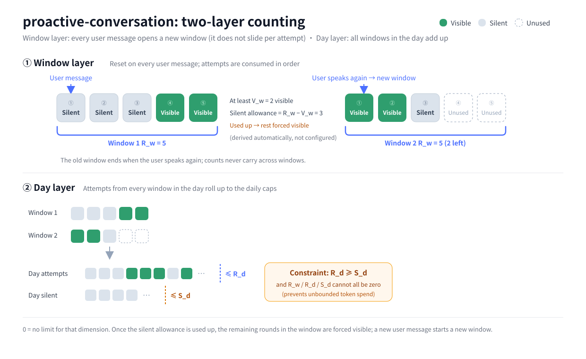

<div align="center">

# proactive-conversation

**Hi～ I'd like to say…**

A proactive-conversation plugin for Hermes · lets your AI reach out at the right moment

**English** | [简体中文](README.zh-CN.md)


</div>

<div align="center">

> Install it, and your AI no longer only waits for you to speak first — it starts a conversation when the moment is right.
> When to speak, how often, quiet hours, and whether tools are allowed are all up to you in the config.

</div>

---

## ⚠️ Please read first

- **What it reads**: a proactive round only reads this session's chat records and cross-session memory as material. Data stays inside your local host; the plugin itself makes no network calls and sends nothing out.
- **What it writes**: only the plugin's own per-session blob (counters, release ticket, declaration mirror). Diagnostics and logs contain field names and short digests only — **never plaintext** `session_key` / `session_id` / `chat_id`.
- **Tools are off by default**: a proactive round may call **no tools at all** (shell, code execution, browser, file writes, payments and messaging are all refused).
- **Enabling tools is at your own risk**: with an explicit `proactive_tools_enabled: true`, the model may perform those actions inside a proactive round. Enable it only in a **trusted environment and trusted sessions**; **you are solely responsible** for any action or consequence (including mistakes, data changes, costs, or outbound messages).

---

## ✨ What it does

- **Speaks up on time**: no need to always ask first — it comes to you at a suitable moment.
- **Considerate, not spammy**: follows your frequency, quiet hours and daily caps.
- **Prompted not to repeat**: the proactive prompt asks the model to add something new; the plugin keeps no cross-round memory of past openers.
- **Optional tool access**: tools are off by default; turn them on only when you want it to act.
- **Config changes apply immediately**: most settings take effect on the next round, no restart.
- **Multi-language**: built-in language rules, with Chinese and English profiles, extensible.

---

## 📊 How counting works



The window layer restarts at every user message; the day layer caps everything the day produced. See the **[configuration reference](docs/configuration.en.md)** for details.

---

## ⚡ Quick start

**1) Install** — clone it under the plugin id as the directory name:

```bash
git clone https://github.com/suhanrain/hermes-proactive-conversation.git proactive-conversation
```

Then place the cloned `proactive-conversation/` here:

```text
<HERMES_HOME>/plugins/proactive-conversation/
```

**2) Enable** — in that profile's `config.yaml`:

```yaml
plugins:
  isolation: in_process        # required
  enabled: [proactive-conversation]
```

**3) Minimal config** (`session_key` and the numbers are placeholders — replace them with yours; see the docs for the full reference):

> ⚠️ **Important: if you set `proactive_tools_enabled` to `true`, the agent may run tools during a proactive round (shell, file writes, messaging, etc.) and can take any unforeseeable risky action — you are solely responsible for the consequences.**

```yaml
plugins:
  entries:
    proactive-conversation:
      allow_gateway_injection: true
      settings:
        trigger_mode: "on"
        proactive_tools_enabled: false
        composition:
          recent_record_seconds: 2592000
          transcript_max_messages: 50
          transcript_window_seconds: 2592000
          memory_window_seconds: 2592000
        session_declarations:
          - session_key: "agent:demo:<platform>:dm:oc_0000000000000000000000000000000"
            enabled: true
            timezone: "Asia/Shanghai"
            dnd_start: "23:00"
            dnd_end: "09:00"
            min_idle_seconds: 600
            max_idle_seconds: 1800
            window_max_attempts: 4
            window_min_visible: 2
            day_max_attempts: 6
            day_max_silent: 4
```

**4) Restart the gateway, then self-check** — in the session, run:

```text
/proactive-check          # is the current config in effect?
```

> For frequency, quiet hours, daily caps, tool access or content sources → see the **[configuration reference](docs/configuration.en.md)**.

---

## 🚫 What it is not

- **Not the chatbot itself**: it does not write the message — your model does. It only decides whether to speak and whether tools are allowed.
- **No direct platform integration, no third-party messages**: it does not embed Feishu/Telegram SDKs; proactive rounds reach **you** only through the Hermes gateway.

---

## ✅ Compatibility

- **Host**: Hermes Agent (verified on **v0.23.0**; testing on other versions is welcome).
- **Isolation**: `plugins.isolation: in_process` is required (in `host` mode the heartbeat and live session are unavailable, and the plugin refuses to load).
- **Python**: 3.12+ (runs on the interpreter shipped with the Hermes host).
- **Dependencies**: none.

---

## 📚 Documentation

| Topic | Where |
|---|---|
| Core architecture and flow (how a proactive round works, why content filtering exists) | **[docs/architecture.en.md](docs/architecture.en.md)** |
| All settings, per-session declarations, two-layer counters, content governance, hot reload | **[docs/configuration.en.md](docs/configuration.en.md)** |
| Multi-language (i18n) and adding a language | **[docs/i18n.en.md](docs/i18n.en.md)** |
| Running the tests | **[docs/testing.en.md](docs/testing.en.md)** |

> `README.zh-CN.md` is the Chinese README, and every doc page has a 中文 / English switcher.

---

## 👤 Author

Built and maintained by [suhanrain](https://github.com/suhanrain).

---

## 📄 License

[MIT](LICENSE).
