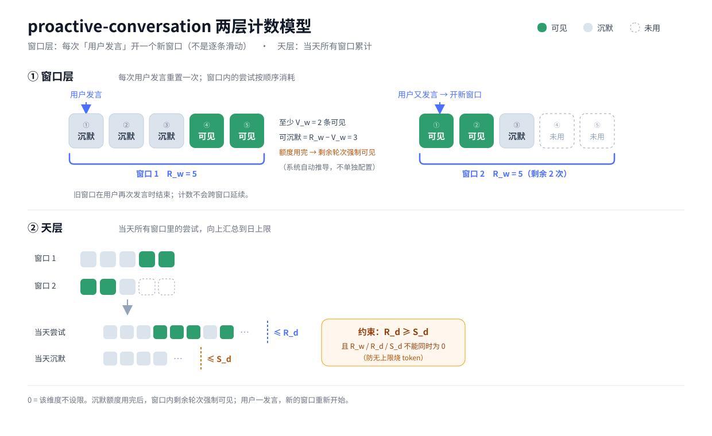

<div align="center">

# proactive-conversation

**Hi～ 我想说……**

Hermes 主动会话插件 · 让你的 AI 在对的时候，主动来找你

[**English**](README.md) | **简体中文**


</div>

<div align="center">

> 装上它，你的 AI 就不只会「等你先开口」了——在合适的时候，它会主动来找你聊两句。
> 什么时候该主动、多久一次、几点别打扰、能不能用工具，全由你在配置里说了算。

</div>

---

## ⚠️ 注意事项（先读）

- **它会读什么**：主动轮只读取本会话的聊天记录与跨会话记忆作为素材；数据留在本机宿主内，插件本身不联网、不外发。
- **它会写什么**：只写插件自己的会话档案（计数器、放行票据、声明镜像）。诊断与日志只记录字段名和短摘要，**绝不打印明文** `session_key` / `session_id` / `chat_id`。
- **工具默认关闭**：主动轮默认**不允许调用任何工具**（命令行、代码执行、浏览器、写文件、支付、发消息全部拒绝）。
- **开启工具 = 后果自负**：显式设置 `proactive_tools_enabled: true` 后，模型在主动轮中可以执行上述操作。请只在**可信环境、可信会话**中开启；由此产生的任何操作与后果（包括误操作、数据变更、费用、对外发送消息）**由开启者自行承担**。

---

## ✨ 它能做什么

- **到点主动开口**：不用你总先问，它会在合适的时机自己来找你。
- **有分寸、不骚扰**：按你设的频率、免打扰时段、每日上限来，不会没完没了。
- **提示模型别重复**：主动轮提示词会要求它讲点新的；插件本身不保存历史开场白。
- **工具权限可选**：默认不让它用工具；你想让它动手时再开。
- **改配置即时生效**：绝大多数设置改完下一轮就生效，不用重启。
- **多语言**：内置语言规则，中英文皆有基础，可扩展。

---

## 📊 计数怎么算



窗口层按「每次用户发言」重新计数；天层在当天所有窗口之上再设总上限。细节见 **[配置参考](docs/configuration.md)**。

---

## ⚡ 快速开始

**1) 安装** —— 克隆时直接指定目录名（与插件 id 一致）：

```bash
git clone https://github.com/suhanrain/hermes-proactive-conversation.git proactive-conversation
```

然后把克隆出的 `proactive-conversation/` 整个放到：

```text
<HERMES_HOME>/plugins/proactive-conversation/
```

**2) 启用** —— 在该 profile 的 `config.yaml`：

```yaml
plugins:
  isolation: in_process        # 必须
  enabled: [proactive-conversation]
```

**3) 最小配置**（`session_key` / 数值都是占位符，换成你自己的；完整说明见配置文档）：

> ⚠️ **重点：如果把 `proactive_tools_enabled` 设为 `true`，Agent 就能够在主动轮次里执行工具（命令行、写文件、发消息等），可能做出任何不可预见的风险操作——后果由开启者自行承担。**

```yaml
plugins:
  entries:
    proactive-conversation:
      allow_gateway_injection: true
      settings:
        trigger_mode: "on"
        proactive_tools_enabled: false
        composition:
          recent_record_seconds: 2592000
          transcript_max_messages: 50
          transcript_window_seconds: 2592000
          memory_window_seconds: 2592000
        session_declarations:
          - session_key: "agent:demo:<platform>:dm:oc_0000000000000000000000000000000"
            enabled: true
            timezone: "Asia/Shanghai"
            dnd_start: "23:00"
            dnd_end: "09:00"
            min_idle_seconds: 600
            max_idle_seconds: 1800
            window_max_attempts: 4
            window_min_visible: 2
            day_max_attempts: 6
            day_max_silent: 4
```

**4) 重启网关，自检** —— 之后它就会在合适时机主动找你；在会话里敲：

```text
/proactive-check          # 看看当前配置是否生效
```

> 想调频率、免打扰、每日上限、工具开关、内容来源等细节 → 看 **[配置参考](docs/configuration.md)**。

---

## 🚫 它不是什么

- **不是聊天机器人本体**：它不写消息，真正说话的还是你的模型，它只决定「该不该开口」「能不能用工具」。
- **不直连平台、不给第三方发消息**：它不集成飞书/Telegram 的 SDK；主动轮只通过 Hermes 网关把消息发给**你自己**。

---

## ✅ 兼容性

- **宿主**：Hermes Agent（已在 **v0.23.0** 上验证可用；欢迎在其他版本上测试并反馈）。
- **隔离模式**：必须 `plugins.isolation: in_process`（`host` 模式下拿不到心跳与实时会话，插件会拒绝装载）。
- **Python**：3.12+（实际运行随 Hermes 宿主自带解释器）。
- **依赖**：零第三方依赖。

---

## 📚 文档地图

| 想了解 | 去哪看 |
|---|---|
| 核心架构与流程（一轮主动对话怎么走、为什么要做内容过滤） | **[docs/architecture.md](docs/architecture.md)** |
| 全部配置项、逐会话声明、两层计数器、内容治理、热加载 | **[docs/configuration.md](docs/configuration.md)** |
| 多语言（i18n）与如何新增语言 | **[docs/i18n.md](docs/i18n.md)** |
| 怎么跑测试 | **[docs/testing.md](docs/testing.md)** |

---

## 👤 作者

由 [suhanrain](https://github.com/suhanrain) 开发与维护。

---

## 📄 许可证

本项目采用 [MIT](LICENSE) 许可。
