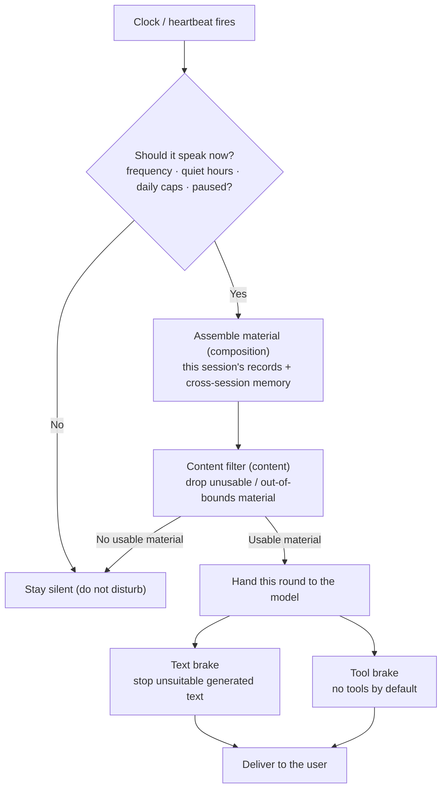

# Core architecture and flow

[**English**](architecture.en.md) | [简体中文](architecture.md)

Start with one diagram of how a proactive round works, then see where **content filtering** (expression boundaries / topic rules) sits and why it is needed.

## Flow of a proactive round

> **Decide first, generate later.** The plugin first decides whether the round is worth speaking (`B`); only if it is allowed does it assemble and filter material (`C`/`D`). If nothing qualifies, nothing is sent and no tokens are burned.

## Where content filtering sits, and why it exists

**Position**: it is the gate between `C` (assemble material) and `E` (hand to the model) — it reviews the assembled chat records / memories, drops the useless or out-of-bounds ones, and hands the rest to the model.

**Why filter** (three reasons, all required):

- **Quality**: messages that are too short, bare acknowledgements ("ok", "got it"), machine-generated filler lines, context-compaction summaries — these carry no information; using them as an opener looks perfunctory, like parroting.
- **Tone and boundaries**: block pressuring / blaming / emotionally manipulative phrasing (e.g. "why haven't you replied yet", "only I understand you"), so a proactive message never turns into harassment or emotional blackmail.
- **Privacy**: never use health values, bills, schedules or other sensitive records as material.

**Why these rules are language-dependent**: many of the checks above are regexes / acknowledgement word lists / minimum length thresholds, which inherently depend on language ("好的" in Chinese is not the same as "ok" in English). They are therefore organised into per-language `LocaleProfile` files, and `proactive_locale` chooses which one to use — see **[i18n](i18n.en.md)**.

## Two brakes after generation

Even when a round is allowed and generated, two protections remain (F/G above):

- **Text brake**: the generated text is checked again; clearly unsuitable text is stopped and not sent.
- **Tool brake**: by default **no tool may be called** (shell, file writes, messaging, etc. are all refused); only an explicit `proactive_tools_enabled: true` opens them. See **[configuration reference · tool access](configuration.en.md)**.

---

For every setting, per-session declarations, the two-layer counters and hot reload → see the **[configuration reference](configuration.en.md)**.
