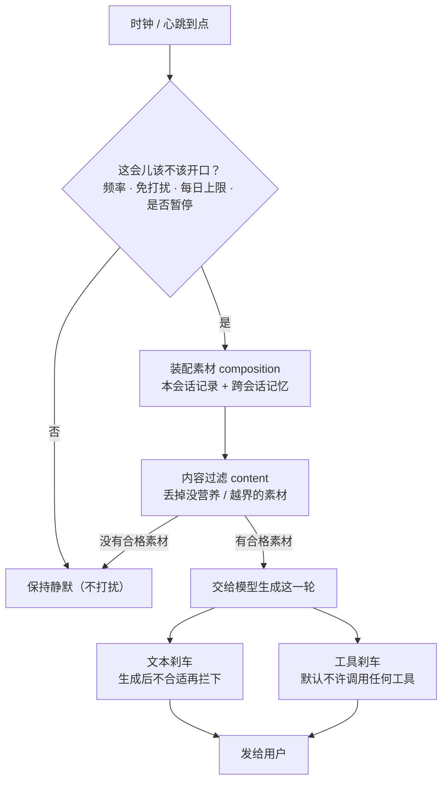

# 核心架构与流程

[English](architecture.en.md) | **简体中文**

一张图先看「一次主动对话」是怎么走的，再讲**内容过滤**（表达边界 / 主题规则）处在哪一环、为什么要它。

## 一轮主动对话的流程

> 说明：**判断在前、生成在后**。插件先决定这一轮值不值得开口（`B`），只有放行了才去装配素材并过滤（`C`/`D`），不合格就不发、不烧 token。

## 内容过滤在哪一环、为什么要它

**位置**：它是 `C`（装配素材）和 `E`（交给模型）之间的**一道闸**——把装配来的聊天记录 / 记忆过一遍，没用的、越界的丢掉，再交给模型。

**为什么要过滤**（三类，缺一不可）：

- **质量**：太短的消息、纯应答（「嗯」「好的」「收到」）、机器灌水的系统行、上下文压缩摘要——这些没有信息量，拿来当话头会显得敷衍、像复读。
- **语气与边界**：拦住**施压 / 指责 / 情感操控**式的措辞（比如「你怎么还不回我」「只有我懂你」这类 PUA 味道的话），避免主动消息变成骚扰或情感绑架。
- **隐私**：不引用健康数值、账单、日程等敏感记录当素材。

**为什么这些规则跟语言有关**：上面很多判断是「正则 / 应答词表 / 长度下限」，天然依赖语言（中文的「好的」和英文的「ok」不是一回事）。所以它们按语言组织成 `LocaleProfile` 档案，由 `proactive_locale` 决定用哪档 —— 详见 **[多语言 i18n](i18n.md)**。

## 生成之后的两道刹车

就算放行并生成了，还有两道保护（上图 `F`/`G`）：

- **文本刹车**：生成出来的话再过一遍，明显不合适就拦下，不发出去。
- **工具刹车**：默认**不许调用任何工具**（命令行、写文件、发消息等全拒）；只有显式 `proactive_tools_enabled: true` 才放开。见 **[配置参考 · 工具开关](configuration.md)**。

---

各配置项的细节、逐会话声明、两层计数器、热加载 → 见 **[配置参考](configuration.md)**。
