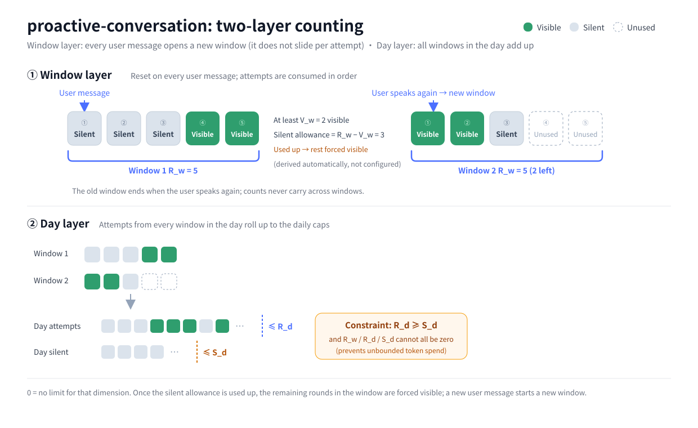

# Configuration reference

[**English**](configuration.en.md) | [简体中文](configuration.md)

This page is the complete configuration reference for `proactive-conversation`. For normal use, the "Quick start" in the [README](../README.md) is enough; come here when you need the details.

All settings live in the profile's `config.yaml`, under `plugins.entries.proactive-conversation.settings.*`. Missing keys use their defaults; **invalid values always fall back to the default and log a `WARNING`** (reason code `config:invalid:<key>`), and never widen a safety limit.

---

## Trigger mode `trigger_mode`

| Value | Meaning |
|---|---|
| `on` | **On**: the plugin keeps its own clock and starts a proactive round when due (internally via "gateway injection"; requires `allow_gateway_injection: true`). This is a **plugin-level setting** (`plugins.entries.proactive-conversation.settings.trigger_mode`), **not** a per-session declaration. |
| `off` | **Default**. Never starts a round (installed but silent). |

Invalid values fall back to `off`.

> Note: `trigger_mode` has only two valid states: `on` (plugin-driven proactive rounds, i.e. gateway injection) and `off`. There is no half-open state.
>
> ⚠️ In YAML a bare `on` / `off` is parsed as a boolean, so prefer the quoted `trigger_mode: "on"`; the plugin accepts both the boolean and the string form.

---

## Plugin-level settings

| Key | Type | Default | Description |
|---|---|---|---|
| `trigger_mode` | string\|boolean | `"off"` | `on` / `off`, see above; bare `on`/`off` in YAML become booleans, and the plugin accepts both. Invalid falls back to `off`. |
| `proactive_tools_enabled` | boolean | `false` | Whether a proactive round may call tools. Default `false` = all disabled; only an explicit `true` opens all tools. See "Tool access". |
| `proactive_prompt_soft` | string\|null | `null` | Prompt template for a round that may stay silent; `null` = built-in default. Placeholders `{visible_since_user}`, `{minimum_visible_replies}`. Invalid falls back to the built-in default. |
| `proactive_prompt_forced` | string\|null | `null` | Template for a forced-visible round (by default it carries "do not repeat or rephrase; add something new" anti-repetition guidance). Same rules as above. |
| `pending_release_ttl_seconds` | number | `600` | Maximum re-check lifetime of an in-flight release ticket (seconds). Must be `>0` and `<=86400`. |
| `event_timestamp_sanity_seconds` | number | `604800` | Trusted bandwidth for an inbound message's own timestamp (seconds, default 7 days). Must be `>0` and `<=2592000`. |
| `composition` | dict\|null | `null` | Content assembly block, **no default**; all four windows/limits must be present. See "Content governance". |
| `session_declarations` | list | `[]` | Declares which sessions may receive proactive messages, and their parameters. See "Per-session configuration". |
| `proactive_locale` | string\|null | `null` (neutral) | Activates language rules; see [i18n](i18n.en.md). |

> For the plugin to actually start rounds (`trigger_mode: "on"`), you must also set `allow_gateway_injection: true` in the same `proactive-conversation` block — it is the master switch that lets the plugin ask the gateway to run a round. Without it, every round is silently ignored (no error, no count).

---

## Per-session configuration and `session_declarations`

An entry names a channel with `session_key`; `session_id` is optional:

- **Omit `session_id` = channel-level authorisation**: the **current** session under that `session_key` is authorised; `/reset` / `/new` (same key, new session) re-authorises automatically on the next round, with no need to edit the id.
- **With `session_id` = exact-instance match**: only that one session instance is authorised. In Hermes a new session is created by `/reset` or `/new` (both produce a new session_id); once it changes, the old `session_id` no longer matches and stops applying — the **new session** must be declared again. (There is no "resume".)

Per-session keys:

| Key | Description |
|---|---|
| `enabled` | `false` = explicitly disable this session. |
| `timezone` | IANA timezone name (e.g. `Asia/Shanghai`), used for quiet hours and the natural-day boundary. |
| `dnd_start` / `dnd_end` | Quiet-hours start/end (`HH:MM`). |
| `min_idle_seconds` / `max_idle_seconds` | Lower/upper bounds of the silence window (seconds). |

### Counter keys (`window_max_attempts` / `window_min_visible` / `day_max_silent` required, `day_max_attempts` optional)

These four limits are the **only** counter model (there is no alternative): the first three **must all be present**, and a missing one makes the whole declaration `off:invalid`; `day_max_attempts` is optional.

| Key | Meaning |
|---|---|
| `window_max_attempts` (`R_w`) | Maximum attempts per window (a new window starts at every user message). |
| `window_min_visible` (`V_w`) | Minimum visible rounds per window. **Silent allowance = `R_w − V_w`**, derived automatically — you **do not** (and cannot) configure a separate "silent" field. |
| `day_max_attempts` (`R_d`) | Daily total attempt cap (token safety valve). |
| `day_max_silent` (`S_d`) | Daily silent cap. |

**How the limits constrain each other** (`0` = no limit for that dimension):

- **Window layer**: each user message opens a new window. A window allows at most `window_max_attempts` (`R_w`) attempts, of which at least `window_min_visible` (`V_w`) must be **visible**; so the silent allowance is `R_w − V_w` (derived automatically — do not write it yourself).
- **Day layer**: per day, at most `day_max_attempts` (`R_d`) attempts and at most `day_max_silent` (`S_d`) silent rounds, with the requirement `R_d ≥ S_d`.
- **All-zero rejection**: if `R_w`/`R_d`/`S_d` are all 0 / unset, the whole declaration is rejected (prevents unbounded token spend).

> In the diagram: each brace = one window; green = visible, grey = silent, dashed = unused allowance.

There is only **one** validation implementation (shared by the runtime, `/proactive-check` and the offline script `scripts/validate_session_declarations.py`), so offline checks and live behaviour cannot disagree.

### What happens if a declaration is wrong

(First, to be clear: this is about **one declaration in the config being wrong**, not "a session broke".) If a declaration is malformed, misses `session_key`, repeats the same key, or has an invalid field, only **that one** becomes "not enabled"; other sessions are unaffected, the plugin does not crash, and it never invents a "default allow". If a session has been **fully shut down**, editing the config cannot revive it — it must produce a **new session (new session_id)** and be declared again.

---

## Tool access semantics

`proactive_tools_enabled` applies **only** to rounds the plugin recognises as its own; ordinary user turns are unaffected.

- Default `false`: in a proactive round **no tool may be called** (shell, code execution, browser, file writes, payments, messaging are all refused), and the prompt switches to "no tools this round" wording.
- Only an **explicit boolean `true`** opens all tools.
- **Tightened by default**: missing key / `null` / any non-boolean is treated as **disabled** (non-booleans also log a `WARNING`).
- One guarantee that **cannot be overridden by a custom prompt**: when `false`, the sentence "there are no tools this round" is appended by code after rendering and is **not part of the prompt template**. So even a custom prompt cannot claim tools are available.

## Configurable prompts

- `proactive_prompt_soft`: wording for a round that may stay silent (the model is free to choose silence).
- `proactive_prompt_forced`: wording for a forced-visible round (below the visible minimum, or when silence is not allowed); by default it carries **anti-repetition** guidance.
- Templates are rendered with `str.format` and support only `{visible_since_user}` and `{minimum_visible_replies}`. Any unusable template → warning + fall back to the built-in default; **never send an empty or broken prompt**.
- Prompts are YAML strings; if they contain `:`, quote them or use a block scalar.

---

## Hot reload and restarts

- **Hot reload (no restart)**: `session_declarations`, `composition` and all plugin-level settings are re-read on **every round**; a `config.yaml` edit takes effect on the next round.
- **Changing config does not clear today's counts**: hot reload only changes the "threshold"; counts already made stay. Lowering a cap takes effect immediately (sends may stop at once), but it **never** rolls back or zeroes today's sends; to see "how many are left today", editing config will not help — wait for the next day.
- **An invalid hot edit is rejected and the last good config is kept** (de-duplicated warning).
- **Timezone changes require a restart**: switching timezone at runtime could double-count or miss a day, so a `timezone` change is rejected and the old timezone is kept — **restart the gateway** (or do an explicit reset) to apply it.

---

## Content governance: `composition` (which chat records / memories a round may use)

In short: `composition` decides which chat records / memories a proactive round is allowed to read as material. For an allowed round, material comes only from its declared **read-only sources** (this session's records + cross-session memory). It has **no default**, and all four items must be present:

| Key | Description |
|---|---|
| `recent_record_seconds` | Time window for considering a record "recent" (seconds). |
| `transcript_max_messages` | Maximum number of this session's records to read. |
| `transcript_window_seconds` | Maximum look-back for this session's records (seconds). |
| `memory_window_seconds` | Maximum look-back for cross-session memory (seconds). |
| `transcript_topic_rules` / `memory_topic_rules` | Optional topic rule tables; defaults to the source's own table. |

**Tightened by default (regardless of source)**: `composition` missing / incomplete / invalid / unreadable → **no assembly, no wake is allowed** (0 calls, 0 deliveries, no state written). Ordinary user messages still pass. Every numeric value is validated individually (rejects `bool`, `<=0`, `inf`/`nan`, out-of-range values); only **field names** go into the problem list, and nothing ever throws. When assembly succeeds but no candidate qualifies, the round stays silent: not counted, not delivered.

---

## Known boundaries and design trade-offs

- **Timezone changes need a restart**: `timezone` is not hot-reloaded; restart the gateway — this keeps counting correct across day boundaries.
- **Unset `proactive_locale` = neutral = no language filtering**: to get Chinese expression boundaries / acknowledgement words / length filtering, set `zh-Hans` explicitly (see [i18n](i18n.en.md)).
- **`composition` has no default**: all four values must be present; otherwise no assembly and no proactive round.
- **Once a session is fully shut down, only a new session can reopen it**: editing config will not revive it; it must produce a **new session** and be declared again. This prevents "a channel accidentally closed, then silently revived by any config edit".
- **Proactive rounds have no tools by default**: to allow tools, set `proactive_tools_enabled: true` explicitly.
