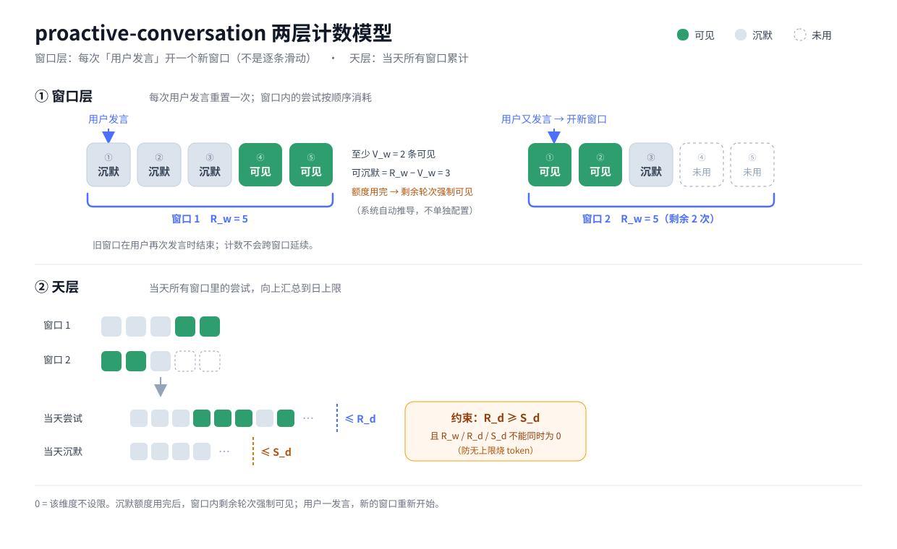

# 配置参考

[English](configuration.en.md) | **简体中文**

本页是 `proactive-conversation` 的完整配置说明。普通使用看 [README](../README.md) 的「快速开始」即可；需要调细节时再看这里。

所有设置都在 profile 的 `config.yaml` 里，路径 `plugins.entries.proactive-conversation.settings.*`。缺项用默认值；**非法值一律回退默认并记 `WARNING`**（理由码 `config:invalid:<键>`），不会放宽任何安全阀。

---

## 触发方式 `trigger_mode`

| 值 | 含义 |
|---|---|
| `on` | **打开**：插件自己掐表，到点主动发起一轮对话（内部走「网关注入」，需要 `allow_gateway_injection: true`）。这是**插件自身的设置**（写在 `plugins.entries.proactive-conversation.settings.trigger_mode`，**不是**会话级声明）。 |
| `off` | **默认**。不主动发起任何一轮（插件装上但保持安静）。 |

非法值回退 `off`。

> 注：`trigger_mode` 只有两种有效状态：`on`（插件驱动的主动轮，内部即网关注入）和 `off`（关闭）。没有其它「半开」状态。
>
> ⚠️ YAML 里裸写 `on` / `off` 会被解析成布尔值，建议写成带引号的 `trigger_mode: "on"`；插件对布尔和字符串两种写法都能正确识别。

---

## 插件级设置一览

| 设置键 | 类型 | 默认 | 说明 |
|---|---|---|---|
| `trigger_mode` | string\|boolean | `"off"` | `on` / `off`，见上；YAML 裸写 `on`/`off` 会变成布尔值，插件两种都认。非法回退 `off`。 |
| `proactive_tools_enabled` | boolean | `false` | 主动轮能否调用工具。默认 `false` = 全禁；只有显式 `true` 才开放全部工具。见「工具开关」。 |
| `proactive_prompt_soft` | string\|null | `null` | 可静默轮的提示词模板；`null`=内置默认。占位符 `{visible_since_user}`、`{minimum_visible_replies}`。非法回退内置默认。 |
| `proactive_prompt_forced` | string\|null | `null` | 强制可见轮模板（默认含「勿重复/改写、必须给出新内容」的去重指引）。规则同上。 |
| `pending_release_ttl_seconds` | number | `600` | 在途放行票据最长复核时长（秒）。须 `>0` 且 `<=86400`。 |
| `event_timestamp_sanity_seconds` | number | `604800` | 入站消息自身时间戳可信带宽（秒，默认 7 天）。须 `>0` 且 `<=2592000`。 |
| `composition` | dict\|null | `null` | 内容装配块，**无默认**，四项窗口/次数必须写全。见「内容治理」。 |
| `session_declarations` | list | `[]` | 声明哪些会话可被主动搭话及其参数。见「逐会话配置」。 |
| `proactive_locale` | string\|null | `null`（中性） | 多语言规则激活开关，见 [i18n](i18n.md)。 |

> 想让插件真正发起主动轮（`trigger_mode: "on"`），还要在同一个 `proactive-conversation` 配置块里打开 `allow_gateway_injection: true`——它就是「允许插件借网关发起一轮对话」的总开关。没打开的话，插件每轮都会被安静忽略（不报错、也不算一次）。

---

## 逐会话配置与 `session_declarations`

一个条目用 `session_key` 指定频道，`session_id` 可选：

- **省略 `session_id` = 频道级授权**：该 `session_key` 下**当前**会话被授权；`/reset` / `/new`（同 key、新会话）会在下一个回合自动重新授权，无需手工改 id。
- **写了 `session_id` = 精确实例匹配**：只授权那一个会话实例。Hermes 里换新会话的方式是 `/reset` 或 `/new`（都会生成新的 session_id）；一旦换了，旧 `session_id` 就对不上、随之失效，需要对**新会话**重新声明。（没有「resume」这回事。）

逐会话键：

| 键 | 说明 |
|---|---|
| `enabled` | `false` = 显式关闭该会话。 |
| `timezone` | IANA 时区名（如 `Asia/Shanghai`），用于免打扰与自然日边界。 |
| `dnd_start` / `dnd_end` | 免打扰起止（`HH:MM`）。 |
| `min_idle_seconds` / `max_idle_seconds` | 静默窗口上下界（秒）。 |

### 计数器键（`window_max_attempts` / `window_min_visible` / `day_max_silent` 必需，`day_max_attempts` 可选）

这四把闸是**唯一**的计数模型（没有别的模型可选）：前三个**必须都写**，缺一个整条声明即 `off:invalid`；`day_max_attempts` 可选。

| 键 | 含义 |
|---|---|
| `window_max_attempts` (`R_w`) | 每个窗口（用户每次发言即重置）最多尝试次数。 |
| `window_min_visible` (`V_w`) | 每窗口至少可见条数。**可沉默次数 = `R_w − V_w`**，由系统自动推导——你**不用**（也不能）自己在配置里另填一个「沉默」字段。 |
| `day_max_attempts` (`R_d`) | 每日尝试总上限（token 安全阀）。 |
| `day_max_silent` (`S_d`) | 每日静默上限。 |

**三个上限怎么互相约束**（`0` = 该维度不设限）：

- **窗口层**：一次「用户发言」算一个窗口。每个窗口最多尝试 `window_max_attempts`（`R_w`）次，其中至少 `window_min_visible`（`V_w`）条要**看得见**；于是可沉默次数 = `R_w − V_w`（系统自动算，别手写）。
- **天层**：一天内最多尝试 `day_max_attempts`（`R_d`）次、最多沉默 `day_max_silent`（`S_d`）次，并要求 `R_d ≥ S_d`。
- **全零拒绝**：若 `R_w`/`R_d`/`S_d` 全为 0／没设，整条声明被拒（防止没有上限地烧 token）。

> 图中：每个大括号 = 一个窗口；绿色 = 可见，灰色 = 沉默，虚线 = 尚未使用的额度。

校验规则只有**一份**（运行时、`/proactive-check`、离线脚本 `scripts/validate_session_declarations.py` 共用），所以离线检查和线上表现不会打架。

### 配置写错了会怎样

（先说清：这里指的是**配置里某条声明写错了**，不是「某个会话坏掉了」。）某条声明格式不对、缺 `session_key`、同一个 key 写了两遍、或字段非法时，只会把**那一条**判为「不启用」，其它会话照常，插件不会崩，也不会擅自编一个「默认允许」。如果某个会话被**彻底关闭**了，改配置救不回，得等它产生**新会话（新 session_id）**后再声明才恢复。

---

## 工具开关语义

`proactive_tools_enabled` **只作用于**插件识别为「自己的主动轮」；普通用户回合不受影响。

- 默认 `false`：主动轮里**任何工具都不可调用**（命令行、代码执行、浏览器、写文件、支付、发消息全拒绝），提示词同时切换为「本轮无工具」措辞。
- 只有**显式布尔 `true`** 才开放全部工具。
- **默认收紧**：缺键 / `null` / 任何非布尔，一律视为**禁用**（非布尔还会记 `WARNING`）。
- 还有一条**不可被自定义提示词覆盖**的保证：`false` 时「本轮没有工具」这句话由代码在渲染后固定追加，**不在提示词模板里**。所以即使自定义提示词，也无法谎称本轮有工具。

## 提示词可配

- `proactive_prompt_soft`：可静默轮（模型可自由选择沉默）的措辞。
- `proactive_prompt_forced`：强制可见轮（低于可见下限或禁止沉默时）的措辞，默认带**去重/反重复**指引。
- 模板用 `str.format` 渲染，仅支持 `{visible_since_user}` 与 `{minimum_visible_replies}`。任何不可用模板 → 告警 + 回退内置默认，**绝不发送空或破损提示词**。
- 提示词是 YAML 字符串；含 `:` 请加引号或用块标量。

---

## 热加载与重启

- **热加载（无需重启）**：`session_declarations`、`composition`、所有插件级设置都在**每一轮**重新读取，改 `config.yaml` 下一回合即生效。
- **改配置不会清空今天的计数**：热加载只是换「门槛」，已经发生的次数照记。把上限调**小**会立刻按新门槛卡住（可能马上就不发了），但**不会**把今天已经发的次数「退回去」或清零；想看「今天还能发几次」，改配置没用，得等新的一天。
- **非法热改被拒并保留上一份好配置**（去重告警）。
- **时区改不了要重启**：运行中切换时区会重复/漏计一天，所以改 `timezone` 会被拒绝并保留旧时区——请**重启网关**（或一次显式 reset）使其生效。

---

## 内容治理：`composition`（决定这一轮能拿哪些聊天记录/记忆当素材）

简单说：`composition` 决定「这一轮主动开口时，允许它翻哪些聊天记录 / 记忆来当素材」。被放行的那一轮，素材只来自它声明的**只读来源**（本会话记录 + 跨会话记忆）。它**没有默认值**，四项必须写全：

| 键 | 说明 |
|---|---|
| `recent_record_seconds` | 认定「够新」的时间窗口（秒）。 |
| `transcript_max_messages` | 本会话记录最多取多少条。 |
| `transcript_window_seconds` | 本会话记录最多回溯多久（秒）。 |
| `memory_window_seconds` | 跨会话记忆最多回溯多久（秒）。 |
| `transcript_topic_rules` / `memory_topic_rules` | 可选话题规则表，缺省用来源自带表。 |

**默认收紧（不区分来源）**：`composition` 缺失/不完整/非法/读不出来 → **不装配、任何唤醒都不放行**（0 调用、0 投递、不写任何状态）。普通用户消息照常通过。每个数值逐项校验（拒 `bool`、`<=0`、`inf`/`nan`、超域值），只把**字段名**写进问题列表，永不抛异常。装配好但候选全不合格时本轮静默，不计次、不投递。

---

## 已知边界与设计取舍

- **时区改了要重启**：改 `timezone` 不热更，得重启网关——这是为了「计数跨天不重不漏」。
- **`proactive_locale` 不配 = 中性 = 不过滤**：想要中文表达边界/应答词/长度过滤，必须显式配 `zh-Hans`（见 [i18n](i18n.md)）。
- **`composition` 没有默认值**：四项必须写全；不写就不装配、不主动开口。
- **会话被彻底关闭后，只能换新会话才能重开**：彻底关掉的会话，改配置不会自动救回来；得让它产生**新的一次会话**后再声明才生效。这样做是为了防止「一个频道被误关后，随便一条配置又把它拉活」。
- **主动轮默认不给用工具**：想让它用工具，必须显式 `proactive_tools_enabled: true`。
